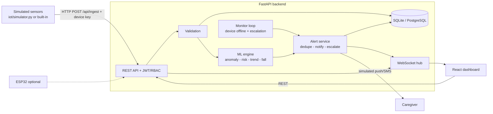
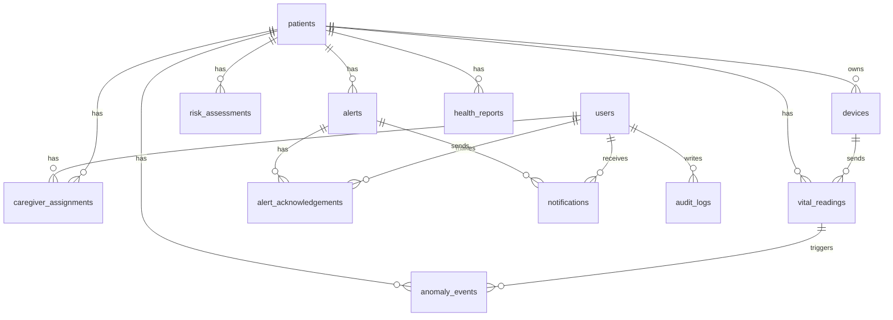

# WARD360 AI - Architecture

## Data flow
1. Sensor posts a reading. 2. Values validated (impossible values rejected, quality flagged). 3. Stored with timestamp.
4. Anomaly engine: personal-baseline z-scores + per-patient Isolation Forest. 5. Interpretable risk engine (reasons, persistence, sensor quality).
6. Fall check + trend check. 7. Alerts created (deduplicated), caregivers notified (simulated). 8. WebSocket pushes to dashboard.
9. Unacknowledged alerts are escalated after `ESCALATION_SECONDS`; silent devices are marked offline after `DEVICE_TIMEOUT_SECONDS`.

## ER diagram

Indexes: `vital_readings(patient_id, ts)`, `risk_assessments(patient_id, ts)`, `alerts(patient_id, status)`, unique `users.email`, unique `(user_id, patient_id)` assignment.

## AI / ML explained (for judges)
- **Personal baseline** per patient; spread (SD) learned from history, bounded to sensible limits.
- **Statistical anomaly**: |z| >= 3 from personal baseline.
- **Isolation Forest** (scikit-learn) trained per patient on that patient's history; flags unusual *combinations*; counted only when also >= 2 SD off baseline to limit false alarms. `model_score` is NOT a clinical probability.
- **Risk engine**: transparent points by deviation size, +1 for persistence (>= 3 of last 5 readings), SpO2 only when low, raised HR/RR ignored during activity, confidence reduced by missing data. Demo values, not clinically validated.
- **Trend engine**: moving average, linear slope + R^2, abnormal-trend flag, 10-step EXPERIMENTAL forecast shown separately.
- **Fall**: accelerometer spike >= 2.5 g (experimental).
- Emergency button/voice path is plain keyword rules + direct API: it never depends on AI.
